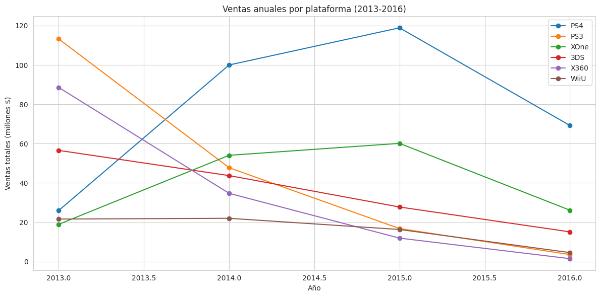
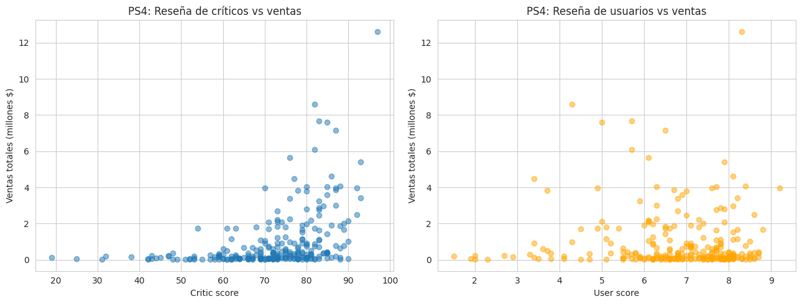
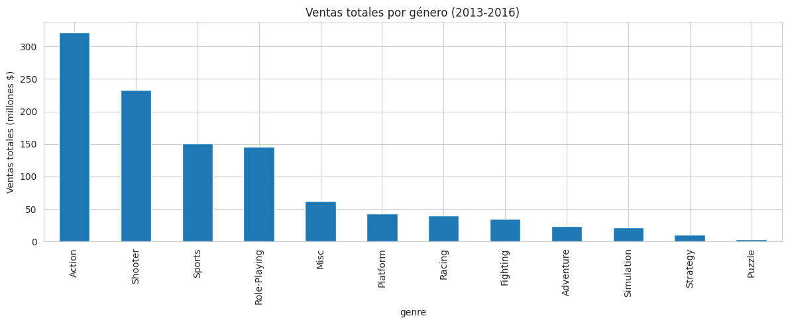
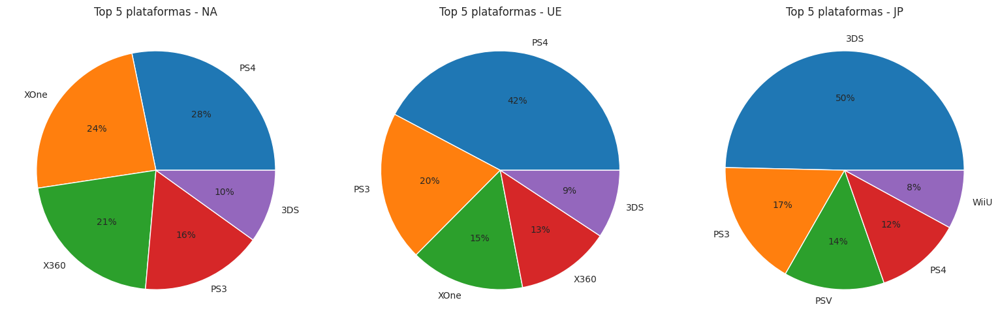

# Análisis de ventas de videojuegos: ¿qué hace exitoso a un juego?

*Proyecto de Bootcamp – TripleTen (Sprint 6, proyecto integrado). Ice es una tienda online simulada; los datos son públicos, modificados por TripleTen.*

## Problema
La tienda online Ice vende videojuegos en todo el mundo y quiere planificar su campaña publicitaria de 2017. Con datos históricos hasta 2016, la pregunta es: **¿en qué plataformas, géneros y regiones conviene invertir?**

## Hallazgos principales
| Pregunta | Hallazgo (período 2013-2016) |
|---|---|
| **Plataformas** | PS4 lidera las ventas (314,14 M), seguida de PS3 (181,43 M) y XOne (159,32 M). PS4 y XOne son las de mayor proyección; PS3, X360 y WiiU van de salida |
| **Reseñas** | La crítica se correlaciona con las ventas (**0,41** en PS4); los usuarios, casi nada (**−0,03**). El patrón se repite en las 6 plataformas principales |
| **Géneros** | Action vende más en total (321,87 M); Shooter tiene la mayor venta media por título (**1,25 M** frente a 0,42 M de Action) |
| **Regiones** | Norteamérica: PS4 (24,8 %) y XOne (21,3 %), Action y Shooter. Japón: 3DS (48,2 %) y RPG (36,3 %) |
| **Hipótesis** | XOne vs. PC (puntuación de usuarios): sin diferencia significativa (p = 0,148). Action vs. Sports: diferencia significativa (6,84 vs. 5,24; p < 0,0001) |

**Recomendación:** concentrar la campaña de 2017 en Action, Shooter y Sports para PS4 y XOne en Norteamérica y Europa; usar una estrategia propia para Japón (RPG, plataformas Nintendo y Sony), y priorizar la prensa especializada sobre las reseñas de usuarios.






## Qué hice
1. **Preparación de datos** (16.715 juegos, 11 columnas): normalicé los nombres de columnas, convertí el año a entero sin imputar los 269 valores ausentes (1,6 %), transformé los 2.424 valores 'tbd' de la puntuación de usuarios en ausentes y decidí **no imputar** las puntuaciones para no inflar artificialmente el rendimiento de juegos sin reseña.
2. **Elección del período:** analicé el ciclo de vida de las plataformas (≈9-10 años, en forma de campana) y, a partir de eso, restringí el análisis a 2013-2016 (2.233 juegos) para que reflejara el mercado de 2017.
3. **Análisis exploratorio:** ventas por plataforma y año, diagramas de caja, correlación entre reseñas y ventas en 6 plataformas, y ventas por género (total, media y número de títulos).
4. **Perfiles regionales:** con una función reutilizable (`region_profile()`) calculé las cuotas de plataformas y géneros, y las ventas por clasificación ESRB en Norteamérica, Europa y Japón.
5. **Pruebas de hipótesis** con la prueba t de Welch (α = 0,05). Al restringir el período, los resultados de ambas hipótesis se invirtieron respecto al histórico completo; documenté por qué eso valida el cambio de período.

## Herramientas
Python · pandas · NumPy · matplotlib · seaborn · SciPy · Jupyter

## Limitaciones
Las puntuaciones de crítica y usuarios faltan en una parte importante de los juegos, así que las correlaciones usan solo los juegos con reseña. Los datos de 2016 pueden estar incompletos. El análisis es descriptivo: la correlación entre crítica y ventas no implica causalidad.

## Estructura del repositorio
```
.
├── README.md
├── video_games_analysis.ipynb   # Análisis completo
├── data/
│   └── games.csv                # Dataset
├── images/                      # Gráficos usados en este README
└── requirements.txt
```

## Cómo ejecutarlo
```bash
python -m venv venv
source venv/bin/activate   # En Windows: venv\Scripts\activate
pip install -r requirements.txt
jupyter notebook video_games_analysis.ipynb
```
